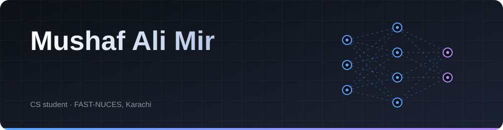

[Portfolio](https://RED-Mushaf-Ali-Mir.github.io)  ·  [LinkedIn](https://www.linkedin.com/in/mushaf-ali-mir-6a32b6295)  ·  [Email](mailto:mushafalimir49@gmail.com)

## About

I'm a CS student at FAST-NUCES in Karachi. I want to do ML Systems research, the place where operating systems and machine learning meet.

I learn by building things from scratch: a `ptrace`-based process tracer, an autograd engine, a decoder-only transformer. Most of my ML work runs on a laptop CPU with no GPU, so I care about what happens underneath the framework.

## What I'm building now

- **Linux face login** (in progress, experimental): face verification with OpenCV (YuNet + SFace) and a from-scratch C PAM module for `sudo`. Liveness detection and FAR/FRR evaluation are still to do. Not for production security. [PLACEHOLDER: repo link]
- **Software load balancer** (in progress): my CS3001 Computer Networks project, with health checks, in Python asyncio, Nginx, Docker and HAProxy. I lead a small team. [PLACEHOLDER: repo link]

## Featured projects

| Project | What it is |
| --- | --- |
| **[Mtrace](PLACEHOLDER-MTRACE-REPO-URL)** | A mini `strace`: traces Linux processes with `ptrace` and shows them in an ncurses TUI. |
| **[Neural_Net_Implementation](https://github.com/RED-Mushaf-Ali-Mir/Neural_Net_Implementation)** and **[Generative-Pre-trained-Transformer](https://github.com/RED-Mushaf-Ali-Mir/Generative-Pre-trained-Transformer)** | A PyTorch-like autograd engine with forward and backward passes, and a decoder-only GPT based on *Attention Is All You Need*. |
| **[Second Harvest](https://github.com/RED-Mushaf-Ali-Mir/second-harvest)** | FastAPI app that runs a small local model (`gemma2:2b` via Ollama, on CPU) to read meal descriptions and suggest which leftovers could be grown. Submitted to the DEV Hacktoberfest Open-Source AI Challenge. |
| **DistilBERT sentiment analyzer** | DistilBERT fine-tuned on IMDb, Yelp and SST-2, deployed on HuggingFace Spaces. |

More on my [portfolio](https://RED-Mushaf-Ali-Mir.github.io), including write-ups of what worked and what failed.

## Learning

- Andrej Karpathy's *Neural Networks: Zero to Hero*, coding along
- Operating systems: OSTEP and the Dinosaur book
- ML systems: mlsysbook.ai
- Reading research papers (just started)

## Tools I use

**Languages:** C, C++, Python, JavaScript  
**ML:** PyTorch, TensorFlow/Keras, HuggingFace, OpenCV  
**Web and data:** React, Node.js, FastAPI, PostgreSQL, Oracle 11g  
**Systems:** Linux, Docker, Git

## Get in touch

I'm open to research and internship conversations. The fastest way is [email](mailto:mushafalimir49@gmail.com) or [LinkedIn](https://www.linkedin.com/in/mushaf-ali-mir-6a32b6295).
